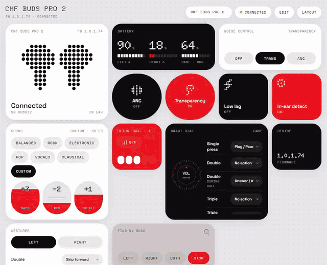

# BudsDesk

A desktop controller for **Nothing** and **CMF** earbuds and headphones, on Windows, macOS and Linux.

It talks to the earbuds directly over Bluetooth, using the same protocol as the Nothing X phone app. You don't need a phone or an account, and nothing goes to the cloud. Everything sits in a bento-grid dashboard you can rearrange.

<p align="center"></p>

<p align="center"><sub>Noise control → custom EQ → Ultra Bass → Find my buds → Dark / Cells themes → resizing a tile in edit mode</sub></p>

> Unofficial. BudsDesk is not affiliated with or endorsed by Nothing Technology. "Nothing" and "CMF" are their trademarks.

## Features

- Battery for each bud and the case, or one reading for headphones, plus in-ear status
- Noise control: ANC (High, Mid, Low or Adaptive, depending on the model), Transparency and Off
- EQ: listening modes or presets, a 3-band custom EQ, and Ultra Bass with levels
- Gesture remapping for each bud, the case **Smart Dial**, and headphone buttons and rollers
- Low lag mode, in-ear detection and Find my buds
- Customisable layout: drag, resize, reshape, recolour or hide tiles. There are four themes: Light, Dark, Cells B/W and Cells colour.
- A device picker when more than one Nothing or CMF device is paired, with the last one used remembered
- A tray icon with quick ANC switching (Windows and Linux)

BudsDesk reads the model from the Bluetooth name and serial number, then shows only the controls that model supports. A model it doesn't know still connects in a safe generic mode with battery, ANC, presets and common gestures.

## Supported models

| Model | Code | Status |
|---|---|---|
| CMF Buds Pro 2 | B172 | ✅ verified on hardware |
| CMF Buds Pro 2 (other SKUs) | B187, B195 | community data |
| CMF Buds, Buds Pro, Buds 2, Buds 2 Plus, Buds 2a | B168, B163, B179/B197, B184, B185 | community data |
| CMF Clip Pro, Neckband Pro, Headphone Pro | B189, B164, B175 | community data |
| Nothing Ear (1), Ear (2), Ear, Ear (3), Ear (3a) | B181, B155, B171, B173, B190 | community data |
| Nothing Ear (a), Ear (stick), Ear (open) | B162/B183, B157, B174 | community data |
| Nothing Headphone (1), Headphone (1) Pro, Headphone (a) | B170, B192, B186/B198 | community data |

"Community data" means the feature table in [`models.py`](models.py) comes from public reverse-engineering work and hasn't been tested on that device here. If you own one, please open an issue with the output of `python tools/probe.py`. That's the fastest way to get a model verified.

## Install

Download the build for your OS from the [Actions](../../actions) artifacts or [Releases](../../releases):

| OS | Download | Notes |
|---|---|---|
| Windows 10/11 | `BudsDesk-windows.zip` → `BudsDesk.exe` | Needs the WebView2 runtime, which Windows 11 already has |
| macOS 12+ | `BudsDesk-macos.zip` → `BudsDesk.app` | It's unsigned, so right-click → **Open** the first time. Allow Bluetooth access when asked. |
| Linux | `BudsDesk-linux.tar.gz` → `BudsDesk/BudsDesk` | BlueZ. Your user needs Bluetooth access, which is usually the default on desktop distros. |

Pair the earbuds in your OS Bluetooth settings first. BudsDesk finds paired Nothing and CMF devices on its own.

**The earbuds accept one controller at a time.** If BudsDesk shows *busy*, close Nothing X or turn off your phone's Bluetooth. It reconnects by itself.

## Run from source

Requires Python 3.10+.

```sh
pip install -r requirements.txt
python app.py                     # last used, or first paired, Nothing/CMF device
python app.py AA:BB:CC:DD:EE:FF   # or a specific one
```

- **Linux:** use your distro's Python. Some standalone Python builds are compiled without Bluetooth sockets. The UI runs on Qt WebEngine, installed by `pywebview[qt]`. The tray needs AppIndicator support. Without it, closing the window quits the app.
- **macOS:** Bluetooth goes through IOBluetooth via `pyobjc-framework-IOBluetooth`. Your terminal app needs Bluetooth permission. There's no tray icon on macOS; the Dock icon takes its place.

## Build

```sh
pip install pyinstaller
python -m PyInstaller --noconfirm budsdesk.spec   # or build.bat on Windows
```

The output goes to `dist/`. GitHub Actions (`.github/workflows/build.yml`) builds all three OSes on every push and attaches the builds to a release when you push a `v*` tag.

## How it works

| File | What it does |
|---|---|
| `buds.py` | The 0x55 RFCOMM protocol: framing, GET/SET commands, state parsing and reconnects |
| `models.py` | Model identity (SKU and name hints) and the per-model feature and gesture table |
| `platform_bt.py` | Paired-device discovery and RFCOMM for each OS: WinSock, BlueZ or IOBluetooth |
| `app.py` | pywebview window, tray, prefs and the device session |
| `ui/` | The dashboard: a single HTML file plus the Cells theme |
| `protocol.md` | Wire format and command reference |

To work on the protocol, use these:

```sh
python buds.py            # protocol self-check against captured frames
python models.py          # model table consistency
python platform_bt.py     # discovery parsers + lists your paired devices
python tools/live_check.py            # live smoke test on real earbuds
python tools/probe.py [MAC] [0xC0xx]  # dump every GET reply (handy for new models)
```

Settings live in `%APPDATA%\BudsDesk` on Windows, `~/Library/Application Support/BudsDesk` on macOS, and `~/.config/budsdesk` on Linux.

## Credits

Protocol and model research builds on these community projects:
- [radiance-project/ear-web](https://github.com/radiance-project/ear-web)
- [oneydef/EarA-linux](https://github.com/oneydef/EarA-linux)
- [SoaOaoS/something-x](https://github.com/SoaOaoS/something-x)

The B172 commands were confirmed live on hardware.

The Cells theme uses [d3-weighted-voronoi](https://github.com/Kcnarf/d3-weighted-voronoi) and [d3-voronoi-map](https://github.com/Kcnarf/d3-voronoi-map) (BSD-3) along with parts of d3 (ISC/BSD). Their licences are in [`ui/vendor/LICENSES.txt`](ui/vendor/LICENSES.txt).
